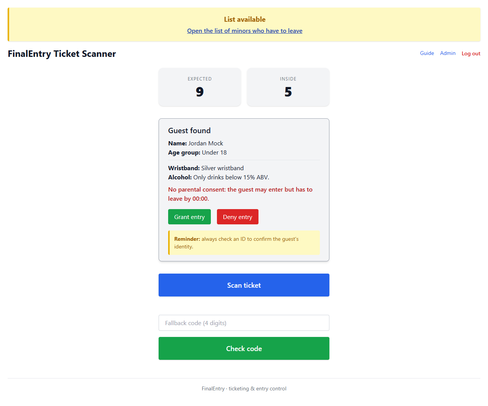
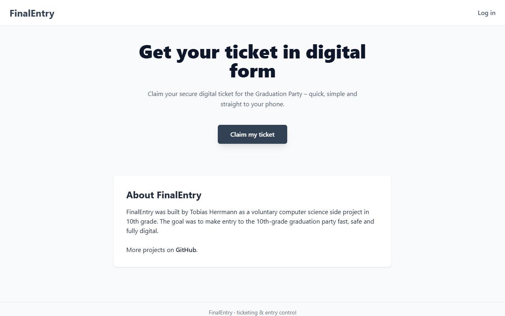
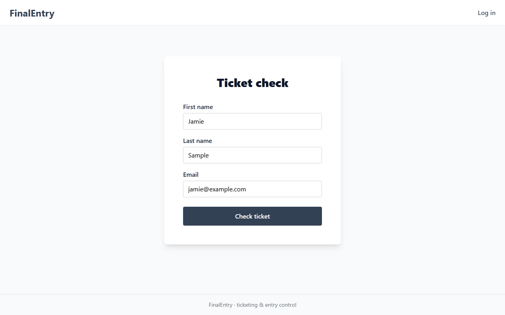
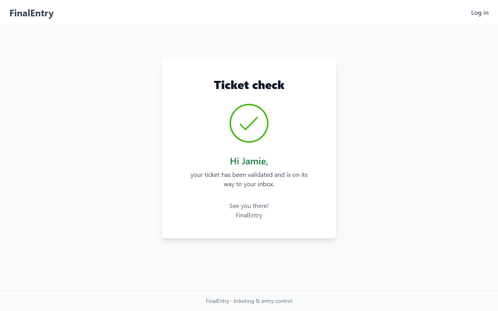
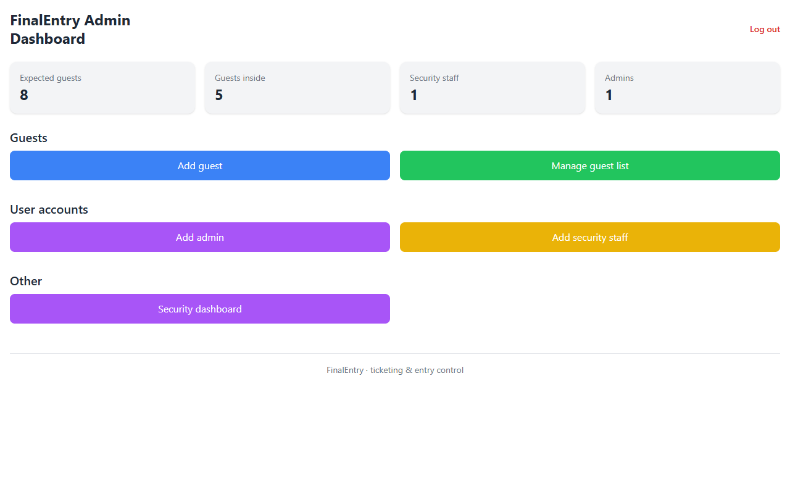
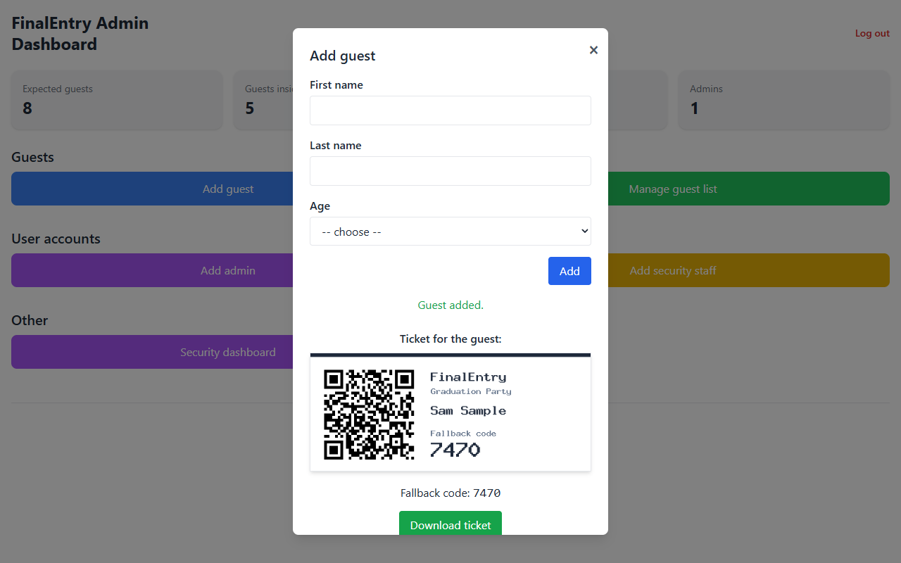
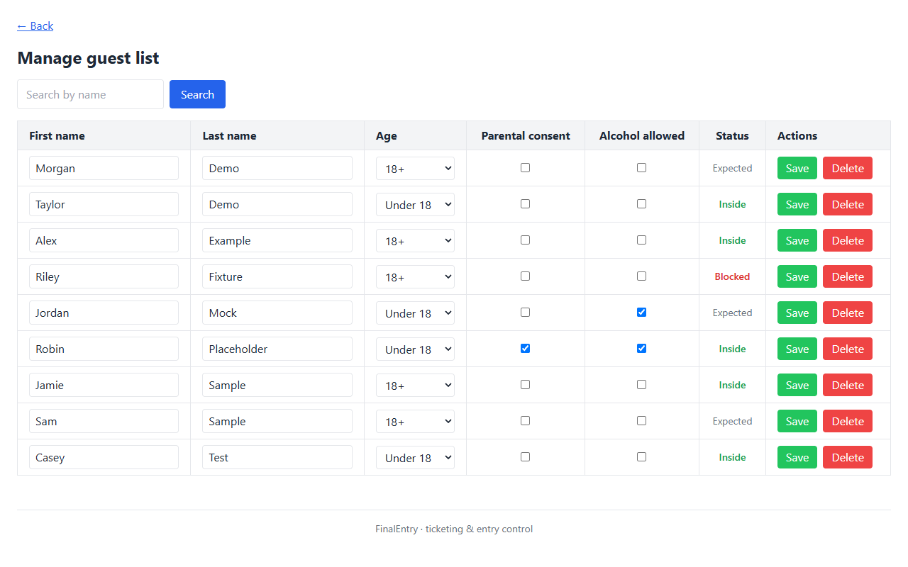
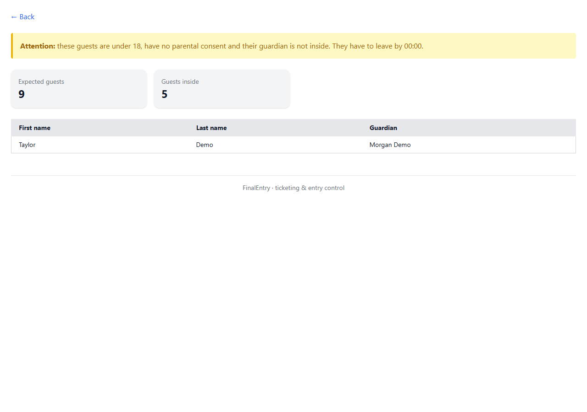
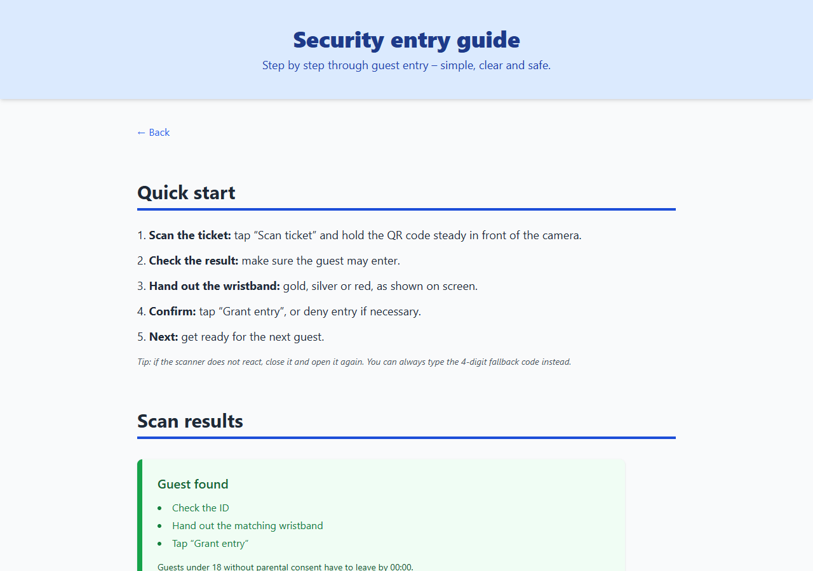
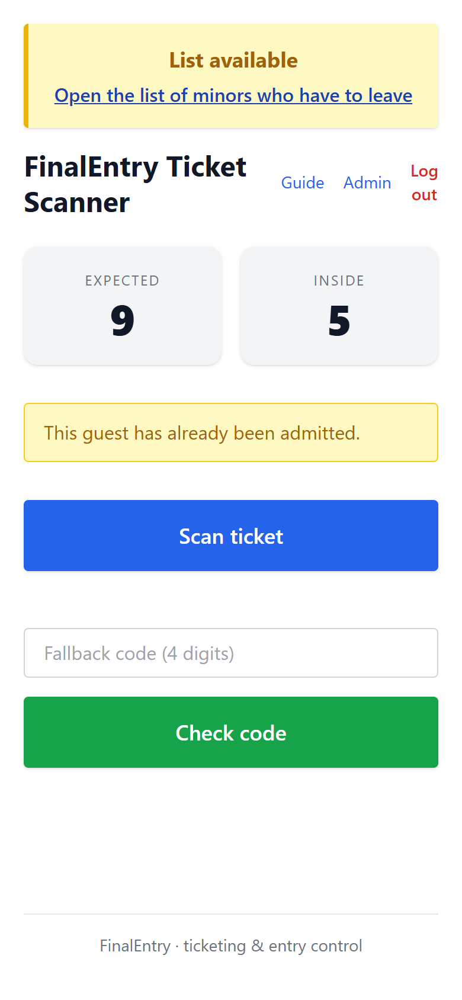

# FinalEntry

**Digital ticketing and entry control for a school graduation party.**

FinalEntry was built as a voluntary computer science project in 10th grade to run the entrance of our
graduation party: organizers create guests and QR tickets, guests claim their ticket by email, and the
security team scans tickets at the door on their phones – including the age rules (wristband colour,
alcohol, curfew for minors) that apply to each guest.



## Features

**For guests**
- Claim a personal ticket with the 4-digit fallback code and your name
- Ticket is sent as a PDF with a QR code to your email address
- Change the linked email address after verifying the ticket

**For admins**
- Dashboard with expected/present guests and staff counts
- Add guests one by one (ticket PNG is generated instantly) or import a JSON list (ZIP of all tickets)
- Edit the guest list: name, age group, parental consent, alcohol permission, status
- Create admin and security accounts, including restricted admins that may only manage the guest list

**For security staff**
- Mandatory onboarding guide before the first shift
- Phone-friendly QR scanner (camera switch, flashlight) with manual fallback-code lookup
- Clear instructions per guest: wristband colour, alcohol rule, midnight curfew for minors without consent
- Grant or deny entry; tickets can only be used once
- From 23:50: list of minors who have to leave because they have no parental consent and their guardian is not inside

## Screenshots

| | |
|---|---|
|  |  |
| Landing page | Claiming a ticket |
|  |  |
| Ticket validated and emailed | Staff login |
|  |  |
| Admin dashboard | Adding a guest generates the ticket |
|  |  |
| Guest list | Minors who have to leave at midnight |
|  |  |
| Onboarding guide for security staff | Scanner on a phone |

## Tech stack

- PHP 8.1+ (no framework, no Composer) with `pdo_mysql`, `gd`, `mbstring`, `zip`
- MySQL 8 / MariaDB 10.6+
- Tailwind CSS (CDN) and [html5-qrcode](https://github.com/mebjas/html5-qrcode) in the browser
- Bundled libraries in `lib/`: [PHPMailer](https://github.com/PHPMailer/PHPMailer), [FPDF](http://www.fpdf.org/), [PHP QR Code](https://sourceforge.net/projects/phpqrcode/)

## Project structure

```
├── index.php              Landing page
├── ticket/                Public ticket claim, email change, PDF mail
├── login/  auth/          Staff login / logout
├── admin/                 Admin dashboard, guest import, guest list, accounts
├── security/              Scanner, entry decisions, guide, leave list
├── includes/              Bootstrap (config, session, CSRF, rate limiting), auth, guest logic, layout
├── assets/                CSS, images, shared JS
├── config/                config.example.php (copy to config.php)
├── database/              schema.sql and optional demo_data.sql
├── scripts/               CLI tool to create accounts
└── lib/                   Third-party libraries
```

## Getting started

1. **Database** – create a database and a user with only the rights the app needs, then import the schema:

   ```sql
   CREATE DATABASE finalentry CHARACTER SET utf8mb4 COLLATE utf8mb4_unicode_ci;
   CREATE USER 'finalentry'@'localhost' IDENTIFIED BY 'a-strong-password';
   GRANT SELECT, INSERT, UPDATE, DELETE ON finalentry.* TO 'finalentry'@'localhost';
   ```

   ```bash
   mysql -u root -p finalentry < database/schema.sql
   mysql -u root -p finalentry < database/demo_data.sql   # optional sample guests
   ```

   Alternatively `docker compose up -d` starts MySQL 8.4 with the schema already imported
   (user `finalentry`, password `finalentry-dev`).

2. **Configuration** – copy `config/config.example.php` to `config/config.php` and fill in the database,
   SMTP and event settings. `config.php` is ignored by git.

3. **First admin account**

   ```bash
   php scripts/create_account.php --username=admin --role=admin --developer
   ```

4. **Run it**

   ```bash
   php -S 127.0.0.1:8080 router.php
   ```

   For production use Apache (the included `.htaccess` files block access to `config/`, `includes/`,
   `lib/`, `database/` and `scripts/`) or point another web server only at the public folders. Always serve
   it over HTTPS – the camera API and secure cookies require it.

## Security

The original school version was reworked with these protections:

- Prepared statements everywhere, output escaped with `htmlspecialchars`
- CSRF tokens on every state-changing request, including logout
- Session cookies are `HttpOnly`, `SameSite=Lax`, `Secure` on HTTPS, strict mode and session ID regeneration on login
- Rate limiting for staff login, public ticket claims and manual fallback-code lookups
- Generic error messages that do not reveal whether a code or a name was wrong
- Ticket emails can only be triggered for the ticket verified in the current session, at most once per minute
- Role and permission checks on the server for every action (restricted admins cannot create admins)
- Entry decisions are atomic, so two scanners cannot admit the same ticket twice
- Security headers: Content Security Policy, `X-Frame-Options`, `X-Content-Type-Options`, `Referrer-Policy`, HSTS on HTTPS
- Uploads are size-limited and processed in memory, temporary files are cleaned up
- Debug output is off by default; errors go to the log, not to the browser

## Third-party licenses

The libraries in `lib/` keep their own licenses: PHPMailer (LGPL 2.1), PHP QR Code (LGPL 3, see
`lib/phpqrcode/LICENSE`) and FPDF (see `lib/fpdf/license.txt`).
